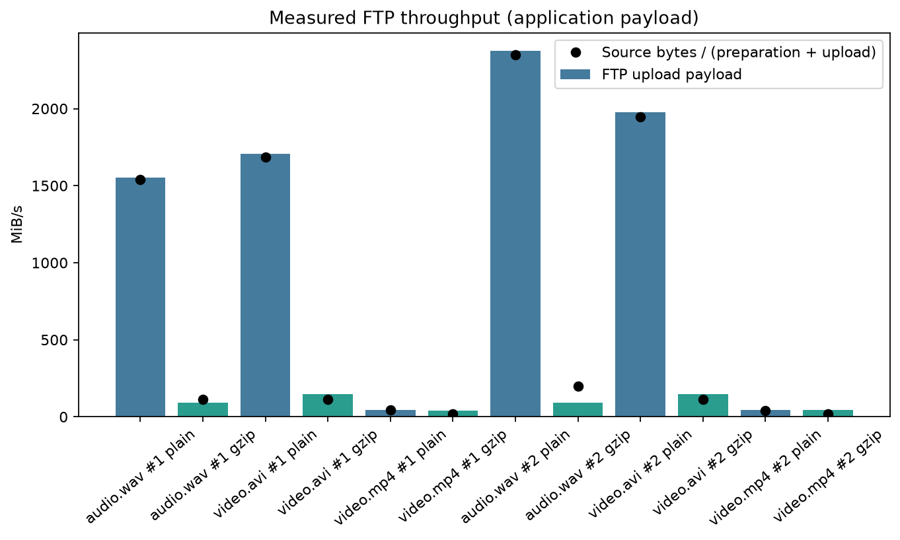
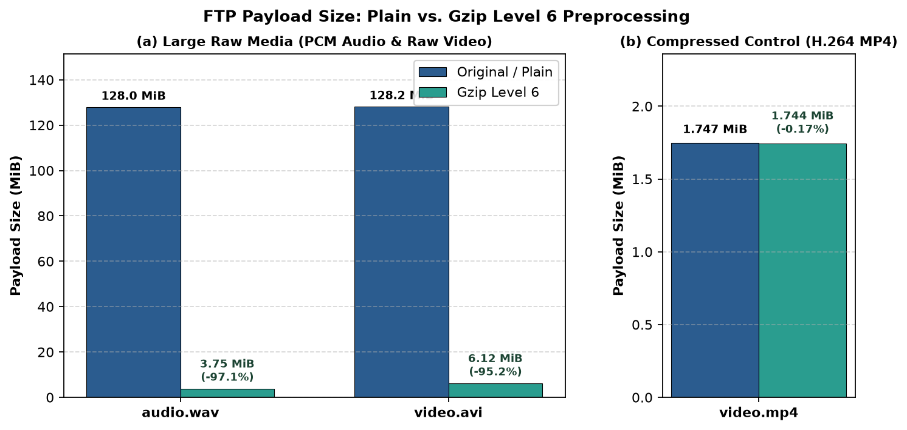
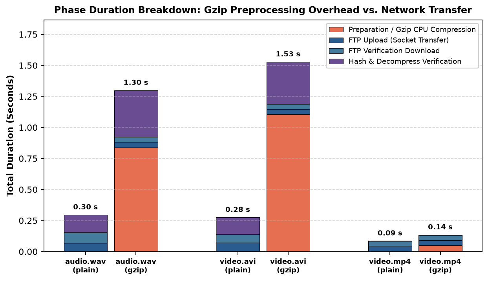
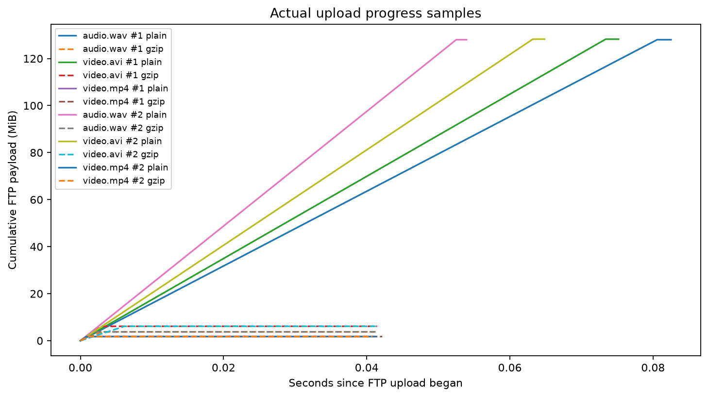

# Large audio/video FTP measurements

These are observed local measurements from 2026-11-15, saved separately
from the automated regression tests. They exercise real TCP FTP transfers,
gzip preprocessing, downloaded content verification, and exported graphs.
They measure this machine's loopback path and filesystem cache, not LAN
capacity, internet upload speed, or durable storage performance.

## Inputs and method

The offline [fixture generator](../tools/media_fixtures.py) creates actual
playable media with FFmpeg, without padding arbitrary bytes onto small
files. The WAV is a synthesized 48 kHz stereo PCM signal; the AVI contains
a moving 640×360 raw YUV420 video pattern. An H.264 MP4 counterpart provides
an already-compressed control. These are generated signals, not recordings.

| Source | Actual bytes | Source MiB | Meaning |
| --- | ---: | ---: | --- |
| audio.wav | 134,217,806 | 128.000 | Large uncompressed PCM audio |
| video.avi | 134,454,314 | 128.226 | Large raw moving video |
| video.mp4 | 1,831,488 | 1.747 | Genuinely compressed counterpart, intentionally smaller |

Two repetitions test every file in both plain and gzip modes: **12 measured
runs**, each with an upload and verification download. Plain always precedes
gzip within a comparison. The engine uses the project's socket-based
client and an isolated instance of its FTP server. No FTP library performs
the transfer. It creates unique temporary remote names, streams files in
chunks, checks downloaded size/SHA-256 after decompression, and cleans up
its own temporary files. All 12 saved runs have `verified=True`.

The [media manifest](results/media-manifest.json) records generation
commands, FFprobe stream metadata, sizes, and SHA-256 hashes. Filenames
are normalized to the portable example directory; measured bytes, hashes,
codec metadata and generation timings are unchanged. Large source media
is generated locally rather than committed to the Git repository.

## Observed results

Values below are arithmetic means of the two repetitions. Total means
preparation plus upload, with the precise exclusions described below.

| Source | Gzip MiB | Bytes saved | Plain total, s | Gzip total, s |
| --- | ---: | ---: | ---: | ---: |
| audio.wav | 3.751 | 97.070% | 0.0689 | 0.8808 |
| video.avi | 6.118 | 95.228% | 0.0710 | 1.1468 |
| video.mp4 | 1.744 | 0.173% | 0.0413 | 0.0900 |

The generated PCM and raw-video patterns compress substantially. They are
regular test signals, so these savings should not be generalized to every
audio or video file. MP4 saves almost no bytes. All three inputs took longer
with gzip on this loopback test because its preparation cost exceeded the
upload time saved. The UI preserves that result instead of labeling every
compression operation faster.

Plain uploads of the large files measured roughly 1551–2373 MiB/s. Those
high values reflect a cached local path with no physical network link.
Two repetitions, fixed mode order, background load, short timings, and
warm caches limit statistical interpretation. There is no claim of a
stable maximum throughput, concurrency saturation, 8 GiB validation, or
successful real-LAN measurement from these observations.

## Graphs and raw data









Each plot also has an SVG counterpart in [results/](results/).
[runs.csv](results/runs.csv) contains one row per mode/repetition/file;
[samples.csv](results/samples.csv) contains the sampled time series.
[results.json](results/results.json) preserves the structured engine output.
Use the raw rows when comparing repetitions rather than reading rounded
bar labels as more precise measurements.

## What each metric means

One MiB is 1,048,576 bytes. Times use a monotonic performance counter.

| Field | Definition |
| --- | --- |
| source_bytes | Original file length |
| payload_bytes | Actual file bytes passed to FTP; compressed length in gzip mode |
| compression_ratio | payload_bytes / source_bytes; undefined for an empty source |
| compression_seconds | Gzip preparation only; zero in plain mode |
| preparation_seconds | Per-mode preparation, including gzip and FTP connection/login |
| transfer_seconds | FTP upload call, including TYPE/data setup and completion reply |
| total_seconds | Preparation through upload completion |
| download_seconds | Verification download call |
| verification_seconds | Reading/hash checking the downloaded content, including decompression |
| round_trip_seconds | Per-mode preparation, upload, verification download and verification |
| throughput_mib_s | payload_bytes / 1,048,576 / transfer_seconds |
| effective_mib_s | source_bytes / 1,048,576 / total_seconds |
| source_hash_seconds | Initial original-source hashing, measured separately |

`total_seconds` does not include the browser-to-app source staging leg,
initial source hashing, verification download, verification hashing, or
cleanup. The UI's end-to-end comparison is therefore preparation plus
FTP upload, not the time from choosing a file until all verification and
browser saving finish. The separate fields make that boundary inspectable.

The sample export records cumulative payload bytes and running-average
speed (bytes divided by elapsed upload time), excluding protocol headers.
The exported time-series graph plots cumulative payload MiB against elapsed
seconds, not instantaneous throughput. Original and gzip traces each start
at their own upload time zero and include final completion latency.

## Reproduce locally

From `Group_Project/FTP`, with Python 3.11+, FFmpeg and FFprobe installed:

```bash
cd Group_Project/FTP
python3 tools/media_fixtures.py \
  --output benchmarks/generated-media --mib 128 --mp4
python3 -m ftp_lab.benchmark --local \
  benchmarks/generated-media/audio.wav \
  benchmarks/generated-media/video.avi \
  benchmarks/generated-media/video.mp4 \
  --repeat 2 --output benchmarks/generated-results --plots
```

The generator refuses to overwrite existing fixture names. Use fresh output
directories for a new observation. WAV and AVI are each at least the requested
size; MP4 is allowed to be much smaller after encoding. Keep enough disk
space for sources, gzip, server copies, and downloads.

`--plots` requires Matplotlib in the interpreter's environment. Omit that
option for standard-library-only CSV/JSON exports. The browser's built-in
SVG graphs do not require Matplotlib. FFmpeg is only a fixture-generation
dependency; existing user-selected media works without it.

To measure another FTP server, omit `--local`, supply `--host`, `--port`,
`--user`, and optionally `--remote-dir`. Its password is read from
`FTP_PASSWORD` or an interactive prompt. Use a trusted lab server and a
writable folder allowing upload, download, and cleanup of the unique
benchmark names. The original source file is never modified.

For a later LAN study, record both machines, connection type, server disk,
background load, larger repetition counts, and varied mode order. Keep
that evidence separate from these original local observations.

## Validation milestones

Before the LAN extension on 2026-11-16, the project suite passed 61 Python and 6 frontend
tests. The internal browser also completed a separate 128 MiB WAV upload,
verified original/gzip comparison, and graph rendering in an isolated app
workspace. Those UI timings are a new observation, not replacements for
the saved 2026-11-15 CSV data.

The later multi-device extension passed **69 Python and 6 frontend tests**,
including the opt-in real LAN-interface case. Its internal-browser check
signed in and uploaded a 128 MiB WAV through the host's LAN URL. This is
functional reachability/transfer evidence; it does not turn the preserved
loopback benchmark graphs into physical Wi-Fi/LAN throughput results.
See [LAN_ACCESS.md](../docs/LAN_ACCESS.md) for reproduction and the distinction
between host-interface testing and a physical second-device test.

The benchmark CLI's `--local` still intentionally starts an isolated
loopback FTP server. To measure a second computer's FTP server, use the
documented remote-server options above, not the browser HTTP port 8080.
Record those new results in a separate output directory instead of
overwriting the original observations.
